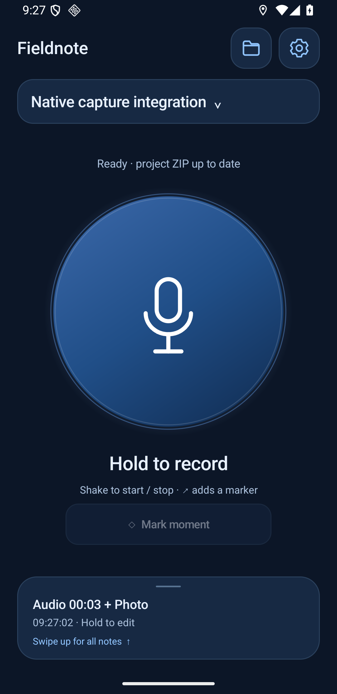

# Fieldnote

A minimalist Android lab notebook for audio, photos, video, and text, organized by project.

- **Capture with one hand.** Hold the microphone to record; swipe to take photos, record video, add text, or mark a moment. The camera preview stays with the recording control.
- **Capture from your home screen.** Record now starts audio in your latest-created project. Tap the mic widget to show the floating hold-and-swipe control over your launcher, without opening Fieldnote after setup.
- **Keep related media together.** Attach photos, video, text, tags, and timestamped markers to an audio note. Search and filter your notes later.
- **Shake to record.** Shake once to start audio and again to stop while Record is open. Choose dark navy or light blue; dark mode is the default.

**Your project is one portable ZIP.** Choose its storage location, and Fieldnote updates it in the background. Original files keep their capture times; a JSON index preserves metadata and relationships. Copy the ZIP to keep the complete project—no hidden database required. The folder button beside Settings opens its location in your file explorer.

Works without an account, Google services, or root access. Android 8.0 or newer.

**[Download the beta APK](https://github.com/DVBeckwitt/FieldNote/releases/tag/v0.2.0-beta.20)**

[User guide](android/BETA.md) · [Build instructions](android/BUILDING.md) · [Validation](docs/VALIDATION.md) · [MIT license](LICENSE)
